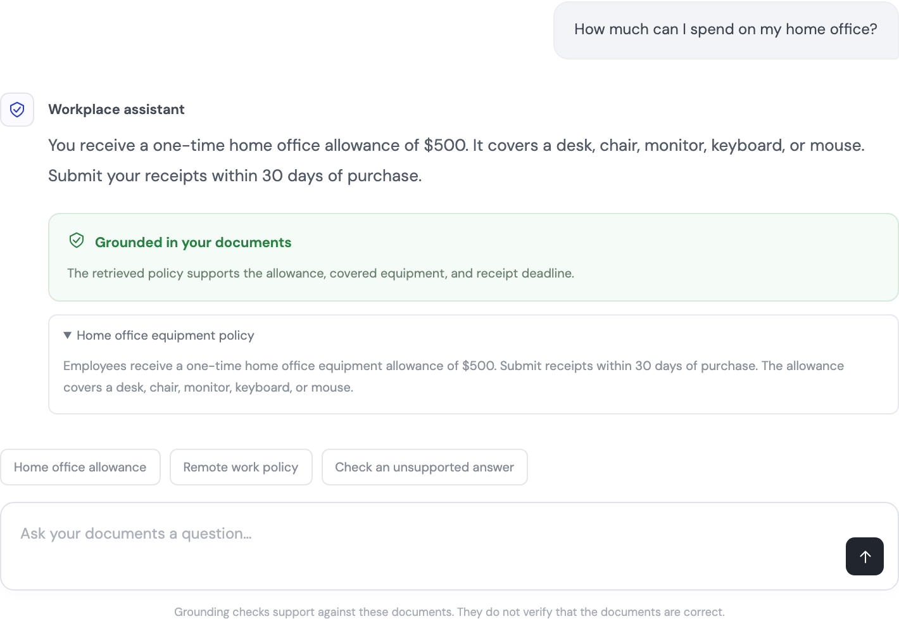

# Grounded agent starter

Build a workplace chat agent that retrieves documents, writes an answer, and checks whether the evidence supports it through LiteLLM.

[Use this template](https://github.com/BerriAI/litellm-grounded-agent-starter/generate) or [fork the repository](https://github.com/BerriAI/litellm-grounded-agent-starter/fork).

```python
answer = await agent.run(question)

verdict = await litellm.guardrails.apply(
    "answer-grounding",
    response=answer,
    messages=source_messages,
)
```

The SDK infers the check direction from `response=`. The configured guardrail returns its structured findings. This starter defines `is_grounded`, `reason`, and `source_ids`; it validates the result before it shows a grounding badge.



This screenshot uses the labelled fixture demo. The model and judge responses are controlled examples, not a measurement of a live model's grounding accuracy.

## Run the local demo

```bash
git clone https://github.com/BerriAI/litellm-grounded-agent-starter.git
cd litellm-grounded-agent-starter
uv sync
uv run grounded-agent-demo
```

Open [the chat UI](http://127.0.0.1:8502) after both services start. Choose “Home office allowance” for a supported answer. Choose “Check an unsupported answer” for a deliberately incorrect answer and a negative grounding verdict.

The launcher runs the real LiteLLM SDK and gateway with local agent and judge fixtures. It generates a temporary gateway key in memory, supplies it to both processes, and binds both servers to localhost. It does not write or print the key. Press Ctrl+C to stop both servers.

If the default ports are in use, choose another pair:

```bash
uv run grounded-agent-demo --chat-port 8512 --gateway-port 4010
```

The SDK and gateway changes for [LiteLLM issue #49217](https://github.com/BerriAI/litellm/issues/49217) are not yet in a released package. `pyproject.toml` pins both to [the implementation commit](https://github.com/BerriAI/litellm/commit/214f5eaa36c301cef7526d7595fe9adec5d55b4f). Installing this source dependency requires LiteLLM's native build prerequisites, including a Rust toolchain. After the feature ships, replace the source pin with the released LiteLLM version.

## Use Amazon Bedrock for managed grounding

Use the supplied `config-bedrock.yaml` when you want a maintained grounding service. It uses LiteLLM's existing Bedrock integration rather than the example custom judge.

In AWS, create a guardrail with contextual grounding enabled. Choose Standard tier for conversational or reasoning responses, and configure the required cross-Region inference profile in a supported region. Classic tier does not support conversational use cases. Set the grounding filter's `enabled` to `true`, choose a threshold for your use case, and set its `action` to `NONE` if your app should receive a negative finding and decide what to display. `BLOCK` retains the guardrail's blocking behavior. See [AWS contextual grounding configuration](https://docs.aws.amazon.com/bedrock/latest/userguide/guardrails-contextual-grounding-check.html) and [filter actions](https://docs.aws.amazon.com/bedrock/latest/APIReference/API_GuardrailContextualGroundingFilterConfig.html).

Use an IAM role or your existing AWS credential profile with permission to call `bedrock:ApplyGuardrail`. Keep credentials outside the checkout. Copy the Bedrock environment example and set your guardrail ID, version, region, agent model, and keys:

```bash
mkdir -p "$HOME/.config/litellm-grounded-agent"
chmod 700 "$HOME/.config/litellm-grounded-agent"
cp .env.bedrock.example "$HOME/.config/litellm-grounded-agent/bedrock.env"
chmod 600 "$HOME/.config/litellm-grounded-agent/bedrock.env"
```

Start the gateway:

```bash
uv run --env-file "$HOME/.config/litellm-grounded-agent/bedrock.env" \
  litellm --config src/grounded_agent/config-bedrock.yaml \
  --host 127.0.0.1 --port 4000
```

Start the chat app in another terminal:

```bash
uv run --env-file "$HOME/.config/litellm-grounded-agent/bedrock.env" \
  python -m uvicorn grounded_agent.app:app \
  --host 127.0.0.1 --port 8502
```

`GROUNDING_PROVIDER=bedrock` selects the application's Bedrock result adapter. `contextual_grounding_from_messages: true` tells LiteLLM to use the system message as reference evidence and the user message as the query. The starter sends the retrieved documents in that system message, the current question in the user message, and the answer through `response=`.

The SDK returns AWS's native structured findings. `parse_verdict` in `results.py` reads `assessments[].contextualGroundingPolicy.filters`, requires a `GROUNDING` assessment, and checks its score, threshold, and detection flag. It does not infer success from the overall `action`: a report-only guardrail can return `NONE` alongside a negative finding. Missing assessments produce “Grounding check unavailable.”

AWS evaluates the reference documents together; this response does not cite the exact document that supported a claim. The UI labels those references “Documents checked.” The application attaches its retrieved document IDs for display, rather than presenting them as AWS-provided citations.

The Bedrock adapter has regression coverage with representative AWS-shaped responses. Live AWS execution has not been verified with credentials in this starter's development session. The fixture launcher continues to use its labelled custom-judge fixtures.

## Connect a custom judge

Copy the environment example to protected storage outside your checkout. Set a gateway key, provider key, and the current model IDs you want to use.

```bash
mkdir -p "$HOME/.config/litellm-grounded-agent"
chmod 700 "$HOME/.config/litellm-grounded-agent"
cp .env.example "$HOME/.config/litellm-grounded-agent/live.env"
chmod 600 "$HOME/.config/litellm-grounded-agent/live.env"
```

The supplied configuration uses OpenAI credentials. Set `AGENT_MODEL` to a provider-qualified model that supports tool calling, and `GROUNDING_JUDGE_MODEL` to one that supports JSON schema output. Adapt the credentials in `src/grounded_agent/config.yaml` if you choose another provider.

Start the gateway:

```bash
uv run --env-file "$HOME/.config/litellm-grounded-agent/live.env" \
  litellm --config src/grounded_agent/config.yaml \
  --host 127.0.0.1 --port 4000
```

Start the chat app in another terminal:

```bash
uv run --env-file "$HOME/.config/litellm-grounded-agent/live.env" \
  python -m uvicorn grounded_agent.app:app \
  --host 127.0.0.1 --port 8502
```

Keep `GROUNDING_DEMO_MODE` unset in live mode. The app configures `litellm.api_base` and `litellm.api_key` once from your environment; the agent and standalone guardrail call use the same gateway connection.

The agent asks the model to call `search_documents`, sends the retrieved documents back as a tool response, and requests an answer. The application then calls `litellm.guardrails.apply` with that answer and the retrieved evidence. The custom guardrail makes one judge request and returns its verdict. It does not generate a second answer to obtain the verdict.

## Use your existing agent

Keep your agent and retriever. Pass the evidence for the final answer to the check:

```python
import litellm
from grounded_agent.results import GroundingVerdict

answer = await agent.run(question)

native_result = await litellm.guardrails.apply(
    "answer-grounding",
    response=answer,
    messages=source_messages,
)
verdict = GroundingVerdict.model_validate(native_result)
```

This custom guardrail returns:

```json
{
  "is_grounded": true,
  "reason": "The policy supports the allowance and receipt deadline.",
  "source_ids": ["home-office"]
}
```

Another guardrail can return a different schema. For Bedrock, use `parse_verdict(native_result, GroundingProvider.bedrock, checked_source_ids)` from `grounded_agent.results` instead of validating it as the custom judge's schema. The SDK exposes the guardrail's recorded structured findings, with LiteLLM's existing credential and sensitive-span sanitization. Treat these as findings rather than the raw upstream HTTP response.

The app shows “Grounded” only when a valid positive verdict cites a retrieved document. It shows “Not supported” for a negative verdict. If the check fails, times out, or returns an invalid result, it shows “Grounding check unavailable” and no positive badge.

## Adapt it for work

Replace `src/grounded_agent/knowledge.json` with your development documents, or replace `search_documents` in `agent.py` with your retriever. Retrieve only documents the current user can access. The included keyword search keeps the example small; it is not a production search service.

`grounding.py` contains the custom judge. `results.py` validates each provider's native result at the application boundary. `app.py` serves the chat API and the fixture endpoint. `demo.py` starts and stops the local fixture services. `index.html` contains the responsive UI and renders document content as text.

An LLM judge can miss errors. It checks support against the supplied documents, not whether the documents are correct. Evaluate supported, contradicted, and incomplete answers from your own use case before enforcing its decisions. Add your application's sign-in and document access controls before you expose the local starter to coworkers.

## Check changes

```bash
uv run pytest
uv run ruff check src tests
uv run ruff format --check src tests
uv run basedpyright
```

The regression tests cover retrieval evidence, negative verdicts, malformed findings, missing citations, failed grounding checks, and Bedrock grounding assessments.
